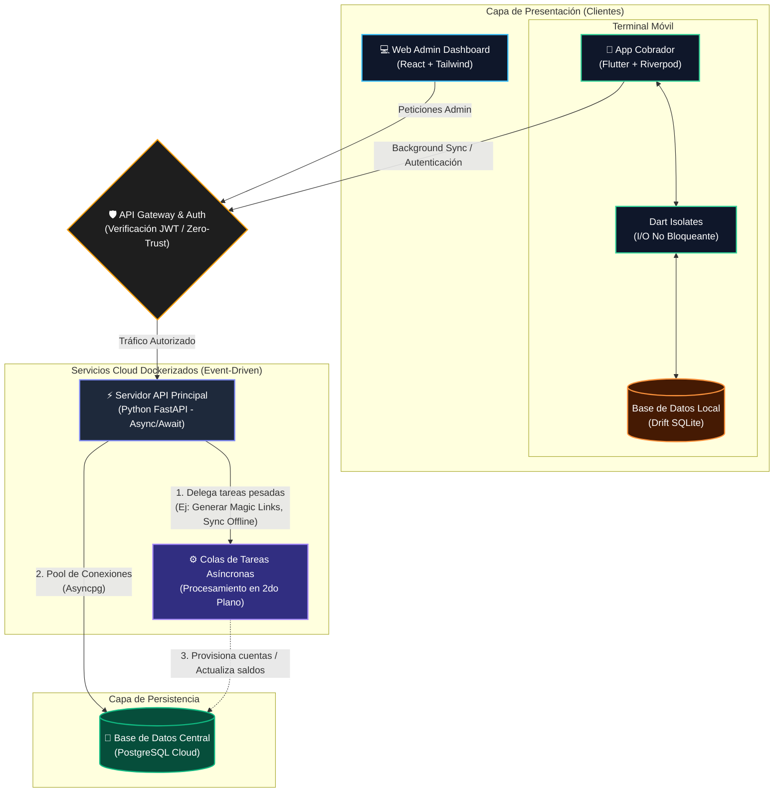

# CrediTrack SaaS - Plataforma Fintech de Recaudo en Terreno

  

 

**CrediTrack** es una plataforma SaaS B2B integral y de misión crítica diseñada específicamente para microfinancieras, empresas de crédito independiente y equipos de cobranza de campo. El sistema digitaliza y automatiza el ciclo operativo completo: administración de cartera, liquidación de cuotas, trazabilidad de cobradores en ruta y sincronización de pagos bajo condiciones de red nula o intermitente (*Offline-First*).

> **Nota sobre el código fuente y privacidad de datos:** Este repositorio constituye una exhibición técnica y arquitectónica (*Showcase*) con fines demostrativos y de portafolio. El código fuente completo, esquemas internos de base de datos y algoritmos de balance financiero se mantienen en repositorios privados bajo estrictos acuerdos de propiedad intelectual. **Todos los nombres, documentos de identidad, números telefónicos y cifras monetarias mostrados en las capturas son datos de prueba ficticios (Mock Data)** generados exclusivamente para entornos de homologación y testing, sin comprometer información real de clientes ni empresas.

---

## 💻 1. Ecosistema Web: Panel Administrativo (React + Tailwind)

El panel de administración para propietarios y auditores fue concebido bajo una arquitectura moderna **Mobile-First** con un sistema de diseño estructurado en **Bento Grid**. Esta disposición garantiza alta densidad de información financiera en tiempo real, adaptabilidad responsiva absoluta y dashboards analíticos claros sin saturación visual.

### Métricas y Reportes

  
  

### Vista de Clientes y Auditoría
Módulo central del administrador para consultar el listado global de prestatarios asignados a cada ruta y auditar en profundidad el historial de crédito detallado, cuotas saldadas y estado de la deuda de cada cliente.

  
  

### Monitoreo de Cobros (Cobros de Hoy)
Esta sección permite hacer seguimiento y control en tiempo real del dinero recaudado por los cobradores en sus rutas diarias, verificando abonos procesados, pendientes y cierres de jornada.

  

### Recibo Digital Público (B2B2C)
Comprobante digital interactivo accesible mediante enlaces tokenizados seguros (*Magic Links*) enviados al cliente por WhatsApp. Permite a los usuarios consultar su saldo y cuotas en tiempo real con cifrado TLS y de solo lectura.

  

### Configuración de Negocio
Centro de control administrativo con soporte multi-rol (Dueño / Cobrador). Permite parametrizar tasas de interés por defecto, modalidades de liquidación diaria/semanal, días festivos y umbrales de alerta de caja.

  

---

## 📱 2. Ecosistema Móvil: App para Cobradores (Flutter + Drift)

Herramienta nativa para operadores en terreno diseñada con una arquitectura de resiliencia extrema **Offline-First**. Garantiza que el cobrador registre transacciones, consulte saldos y realice cálculos financieros instantáneos incluso en zonas rurales sin cobertura móvil.

### 🎥 Experiencia de Usuario (Motion UI & Glassmorphism)
La aplicación implementa microinteracciones fluidas a 60 FPS, navegación háptica con barra flotante desacoplada y estética *Glassmorphism* con desenfoque de fondo en tiempo real para optimizar la ergonomía y velocidad de captura en calle.

  <video src="

https://github.com/user-attachments/assets/0f3bc2c9-ea8a-4d10-962b-50deb2fd6273

" width="35%" autoplay loop muted playsinline></video>
  <video src="

https://github.com/user-attachments/assets/6cb05d95-e123-4f5c-83e2-4a8399708ae5

" width="35%" autoplay loop muted playsinline></video>

### Operación en Terreno (Offline)
La app persiste cada abono y gasto localmente mediante **Drift / SQLite**, calculando los balances en el dispositivo en microsegundos. Al reestablecer conectividad celular o Wi-Fi, el motor de sincronización procesa las colas pendientes contra el servidor central sin interrupciones ni pérdida de datos.

  

### Seguridad, Accesos y Cifrado
Persistencia de sesiones de alta seguridad mediante tokens cifrados en hardware con **Flutter Secure Storage** (Keystore en Android / Keychain en iOS). La interfaz proporciona módulos dedicados para autenticación biométrica, reseteo de claves con tokens de un solo uso y políticas de revocación remota de dispositivos.

  
  

---

## 🛠️ 3. Arquitectura Asíncrona y Stack Tecnológico

* **Frontend Web:** React 19, Vite, Tailwind CSS, Lucide Icons, Framer Motion.
* **Aplicación Móvil:** Flutter (Clean Architecture), Riverpod (State Management), Drift / SQLite (Base de datos local), Flutter Secure Storage.
* **Backend & Servicios:** Python (FastAPI / SQLAlchemy), Pydantic, Uvicorn, Docker & Docker Compose.
* **Bases de Datos & Almacenamiento:** PostgreSQL en la nube (instancia SaaS centralizada) y SQLite embebido en dispositivos cliente.

### 🔥 Topología de Alto Rendimiento (Event-Driven)
El ecosistema está diseñado para manejar alta concurrencia sin bloqueos (Non-blocking I/O) en ninguna de sus capas:
* **Backend Asíncrono:** El servidor principal en FastAPI delega las tareas pesadas a *Workers* en segundo plano. Por ejemplo, el aprovisionamiento de nuevos cobradores mediante **Magic Links** (enlaces tokenizados de un solo uso) se procesa en colas asíncronas, respondiendo a la petición web en milisegundos.
* **Base de Datos No Bloqueante:** Implementación de un pool de conexiones concurrentes mediante `Asyncpg`.
* **Mobile Fluido a 60 FPS:** En la aplicación móvil, las operaciones de lectoescritura contra SQLite y la sincronización HTTP se ejecutan en *Dart Isolates* (hilos secundarios), garantizando que el *UI Thread* y las animaciones jamás sufran caídas de frames (*jank*).

---

## 🧠 4. Retos de Ingeniería Resueltos

1. **Resolución de Conflictos Offline y Colas Idempotentes:**
   Implementación de un motor de sincronización bidireccional con marcas de tiempo lógicas y hashes de transacción. Cuando múltiples abonos se registran sin conexión en zonas remotas, el backend procesa las colas asegurando idempotencia estricta, conciliando balances sin duplicaciones ni inconsistencias contables.

2. **Prevención de Layout Blowouts en Motores Móviles Restrictivos:**
   Optimización del motor de renderizado CSS/Tailwind para mitigar fallos de desbordamiento horizontal (*viewport blowout*) en navegadores in-app y navegadores propietarios (ej. WebView de Huawei). Se implementaron contenedores estrictos con límites `overflow-x-hidden`, empaquetado de texto forzado (`break-words`) y dimensionamiento elástico no destructivo en componentes gráficos.

3. **Seguridad de Sesiones en Cold Start:**
   Garantía de inicialización atómica de credenciales en arranques en frío de la aplicación móvil. El pipeline de inicio verifica la integridad del almacenamiento seguro local antes de montar el árbol de widgets de Riverpod, evitando parpadeos de redirección no autenticada y asegurando persistencia transparente en modo avión.

---

## 📄 Licencia

Este es un proyecto comercial de código cerrado. Todos los derechos reservados © 2026 Carlos Acosta. Queda prohibida la reproducción total o parcial del diseño, material multimedia y la arquitectura aquí expuesta sin autorización expresa.
