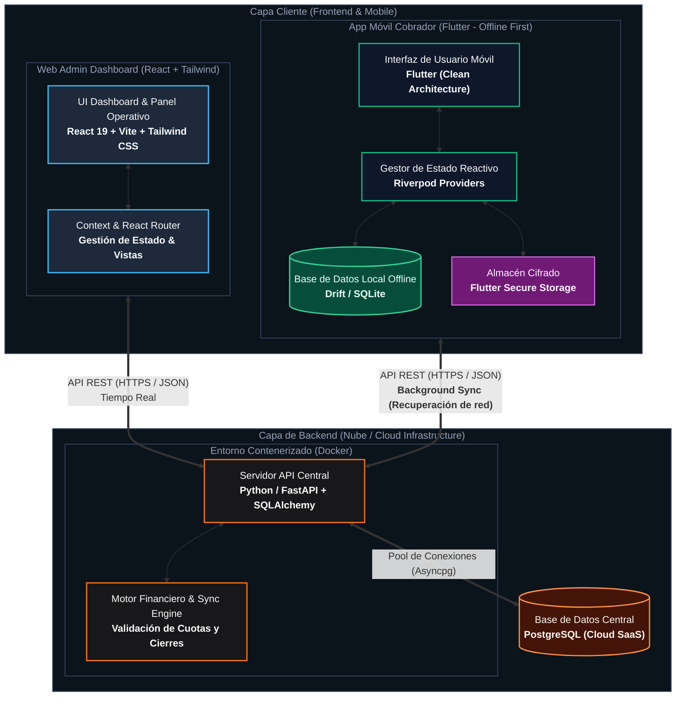

# Arquitectura de la Plataforma CrediTrack SaaS

Diagrama general de comunicación y diseño de capas de la plataforma **CrediTrack**, destacando la arquitectura *Offline-First* en el cliente móvil, el panel administrativo web y los servicios backend contenerizados en la nube.

